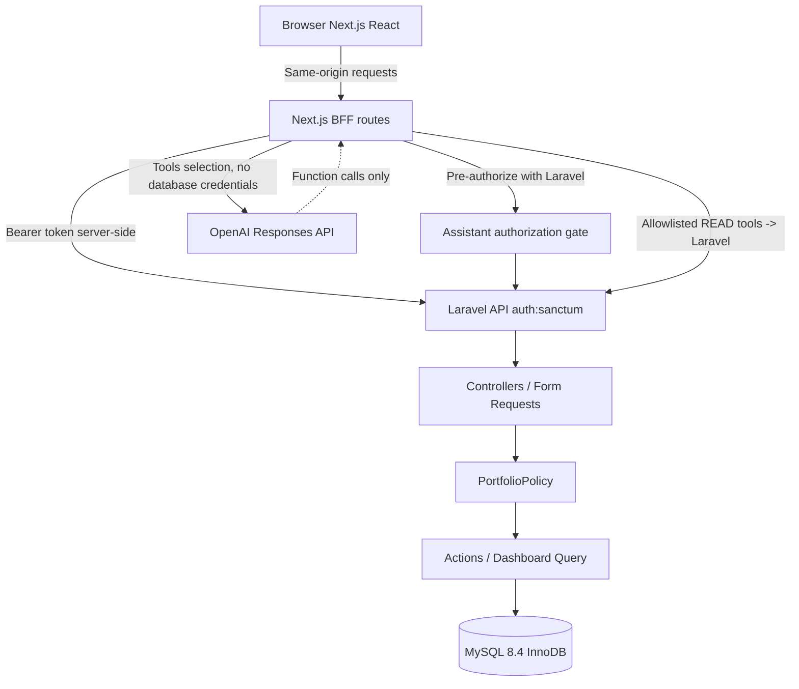

# Architecture and component responsibilities

## Boundary map



## Why a BFF?

The React browser never sees Laravel's API token; a short-lived token is encrypted into an HttpOnly SameSite cookie and is decrypted only by Next.js server routes. Unsafe routes check the exact configured `APP_ORIGIN` and JSON Content-Type. Laravel remains the source of truth for authorization and validation. A BFF also avoids exposing Laravel CORS settings directly to the browser. Trade-off: another deployable tier and session key lifecycle; it is not free. `BFF_SESSION_SECRET` must be strong, shared across horizontal Next.js instances, and rotated with a session invalidation procedure.

## Controller orchestration

- **Controllers:** parse/authorize/dispatch/return JSON only. Avoid transaction or pricing logic here.
- **Form Requests:** reject unsupported asset type, missing fields, malformed UUID, negative prices or invalid precision; defense in depth, **not** primary authorization.
- **Policies:** `view` for any membership; `mutate` only for owner/editor; all ordinary API and agent paths re-use these rules.
- **Actions:** `CreateAsset`, `RecordTransaction`, `RecordValuation` manage transactional write units, invariant checks, idempotency and row locking.
- **Queries:** `PortfolioDashboard` computes database-side totals/allocation and bounded display rows.
- **Models:** Eloquent associations and fillable fields; no hidden business workflows in controllers.

## Transaction recording sequence

```mermaid
sequenceDiagram
  participant U as User
  participant N as Next.js BFF
  participant C as Laravel Controller
  participant A as RecordTransaction
  participant D as MySQL
  U->>N: POST /portfolios/p/assets/a/transactions
  N->>C: Bearer token + validated origin
  C->>C: PortfolioPolicy.mutate + asset tenant check
  C->>A: execute(scope, payload)
  A->>D: BEGIN; find existing idempotency key
  A->>D: SELECT asset FOR UPDATE
  A->>D: Recheck key, conditional DECIMAL quantity update
  A->>D: INSERT immutable transaction (UNIQUE key)
  D-->>A: COMMIT / rollback on error
  A-->>C: Transaction record
  C-->>U: 201 / 403 / 404 / 422
```

Concurrent same-key requests that compete across different assets are resolved by the database UNIQUE constraint. The losing insert rolls back the quantity change; the application checks for the committed winner after rollback. This design requires actual MySQL concurrency tests before making throughput or serializability claims.

## AI flow

A user supplies only a question. BFF owns the portfolio route and session; it asks Laravel to authorize the exact portfolio ID prior to any paid model call. Tool names are allowlisted and argument schema must be empty. The returned data comes from a Laravel endpoint that checks `view` **again**. Tool outputs are data, not instructions; the model receives no SQL/credentials. Second LLM turn streams text SSE; any provider issue is reported as an error. No write function is offered.

## Scalability boundaries

This is a small MVP: full-portfolio aggregation is per-request and asset details are bounded to 100. Indexes support scoped access and recent transactions. For larger portfolios, use pagination, selective projections, read-model/materialized summaries with reliable invalidation, and measurements of `EXPLAIN` + real latency before caching. Redis, background jobs, websocket sync and multi-region replication are deferred until a proven workload justifies them.
