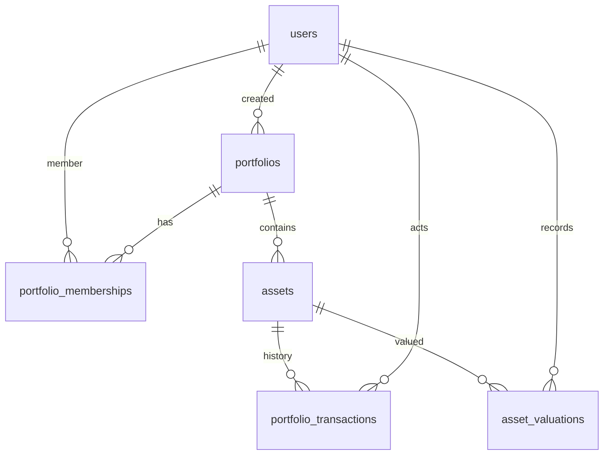

# MySQL data model and correctness invariants

## Logical ER diagram

## Entity definitions

| Table | Key / relations | Important constraints or indexes |
| --- | --- | --- |
| `users` | `id` PK; email unique | Password hash, no public self-signup in MVP. |
| `personal_access_tokens` | Sanitized Sanctum tokens | Server-only cookie storage, 8-hour expiry. |
| `portfolios` | `id` PK; `created_by` -> user | USD-only check. Ownership **permission** is membership, not just `created_by`. |
| `portfolio_memberships` | membership ID; FKs to portfolio/user | `(portfolio_id,user_id)` unique; `(user_id,portfolio_id)` indexed; role check owner/editor/viewer. |
| `assets` | PK; `portfolio_id` FK | `(portfolio_id,type,name)` unique; `(id,portfolio_id)` unique for composite children; `(portfolio_id,type)` index; nonnegative quantity/mark; cash value 1. |
| `portfolio_transactions` | PK; portfolio/asset/actor | composite asset+portfolio FK; `(portfolio_id,idempotency_key)` unique; `(portfolio_id,executed_at,id)` for recent feed; positive quantity, nonnegative execution price. |
| `asset_valuations` | PK; portfolio/asset/recorder | composite asset+portfolio FK; `(asset_id,valued_at,id)` index; nonnegative mark; append-only by API. |

**Precision:** `DECIMAL(24,8)` gives 16 digits before decimal and eight after. Monetary products/aggregates are calculated in SQL. JavaScript `Number` is used **only** for presentation and chart proportions, not for persisted finance math. Limits/rounding are explicitly documented; no FX conversion is attempted.

**Composite tenant safety:** `assets` has UNIQUE `(id,portfolio_id)`; both transactions and valuations have FOREIGN KEY `(asset_id,portfolio_id)` → `assets(id,portfolio_id)`. This blocks linking a row with `portfolio_id=B` to an asset in portfolio A, even if an API bug misses a tenant filter.

**Immutable historical facts:** transaction and valuation rows are inserted, never updated/deleted via the prototype API; the asset row caches the latest mark and quantity. The cache is updated atomically with its corresponding history record. A real audit ledger would add durable actor/event metadata and tighter immutable database permissions.

## Algorithms and failure cases

- **Open asset:** begin transaction → create asset → first valuation → opening `buy` transaction → commit. On any failure rollback all three.
- **Record buy:** ensure role + asset scope → begin transaction → existing key? compare payload → lock asset row → recheck key → increment using SQL `CAST(? AS DECIMAL(24,8))` → insert transaction → commit.
- **Record sell:** same, except conditional update checks `quantity >= requested` atomically; failed update becomes HTTP 422 and no ledger row.
- **Retry:** repeated key and identical data return existing transaction (201). Same key with changed asset/type/quantity/price returns 422.
- **Update valuation:** lock asset → insert history row → update current price and valued_at → commit; execution price is never rewritten.
- **MySQL deadlock:** the Laravel transaction retries up to three times, then surfaces the failure; observability and load testing remain follow-up work.

**Important limit:** the code is intended to be run against MySQL 8.4, not SQLite; DB `CHECK` constraints are conditional on MySQL driver, and concurrency claims must be tested with two genuine database connections. MySQL's default `REPEATABLE READ` and unique-row `FOR UPDATE` locks have specific visibility/locking semantics; the post-rollback duplicate-key path is intentional.

## Why these indexes?

- `(portfolio_id,idempotency_key)`: unique retries, concurrency conflict resolution.
- `(portfolio_id,executed_at,id)`: recent activity ordered by timestamp and PK.
- `(portfolio_id,type)`: type allocation and scoped holdings.
- `(user_id,portfolio_id)` plus unique `(portfolio_id,user_id)`: membership filtering both directions.
- `(asset_id,valued_at,id)`: valuations history by asset/time.

They reflect current queries; future performance should be measured using `EXPLAIN ANALYZE`, slow query log and realistic loads before adding redundant indexes.

## Known limitations / changes for production

No foreign-currency holdings, no corporate actions/splits, no dividend/tax accounting, no reconciliation, no multi-user invitation UI, no irreversible delete path, no double-entry ledger, no event sourcing and no live pricing. A true brokerage/payment product would need accounting-domain review, immutable settlement records and regulatory consideration. Do not describe this prototype as a production-grade brokerage system.

## Primary references

- MySQL 8.4 [locking reads](https://dev.mysql.com/doc/refman/8.4/en/innodb-locking-reads.html)
- MySQL 8.4 [DECIMAL](https://dev.mysql.com/doc/refman/8.4/en/fixed-point-types.html)
- Laravel 12 [database transactions](https://laravel.com/docs/12.x/database#database-transactions)
